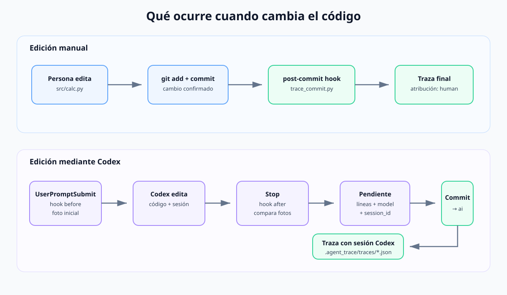

# Demo Agent Trace

Proyecto de demostración para atribuir cada línea de código a una persona o a
una sesión de Codex. La aplicación de ejemplo es una calculadora sencilla y
las herramientas de `tools/` crean y consultan el historial de atribución.

## Estructura del proyecto

```text
.
├── README.md                         ← esta guía
├── src/
│   └── calc.py                       ← funciones de ejemplo: módulo y potencia
├── tools/
│   ├── agent_trace.py                ← crea manualmente una traza para el último commit
│   ├── codex_trace_hook.py           ← hook de Codex: detecta líneas añadidas por el agente
│   ├── trace_commit.py               ← hook post-commit: convierte pendientes en trazas definitivas
│   ├── trace_blame.py                ← equivalente a `git blame` con autor humano/IA
│   ├── trace_history.py              ← historia de una línea y su atribución en cada commit
│   └── trace_stats.py                ← analíticas históricas de líneas atribuidas
├── .codex/
│   └── hooks.json                    ← ejecuta el hook de Codex al inicio y al final de un turno
├── .agent_trace/
│   ├── .pending/                     ← estado temporal; se puede borrar sin perder trazas finales
│   └── traces/                       ← registros JSON definitivos de atribución
└── .git/hooks/post-commit            ← ejecuta `tools/trace_commit.py` tras cada commit
```

Los directorios `__pycache__/` contienen bytecode de Python generado
automáticamente; no forman parte de la lógica del proyecto.

## Qué ocurre al modificar código



En resumen: una edición manual no genera un evento pendiente y se registra
como `human`. Una edición realizada durante un turno de Codex queda asociada a
su `session_id`; cuando se hace el commit, el hook post-commit la transforma en
una traza `ai` con una URL `codex://sessions/<session_id>`.

## Hooks usados

| Ubicación | Evento | Propósito |
| --- | --- | --- |
| `.codex/hooks.json` | `UserPromptSubmit` | Ejecuta `codex_trace_hook.py before` antes de que Codex edite; guarda una foto temporal del árbol de trabajo. |
| `.codex/hooks.json` | `Stop` | Ejecuta `codex_trace_hook.py after`; compara la foto inicial y final y guarda las líneas añadidas junto con sesión y modelo. |
| `.git/hooks/post-commit` | Después de `git commit` | Ejecuta `trace_commit.py`; clasifica cada línea añadida como `ai`, `human` o `mixed` y escribe el JSON definitivo. |

`.agent_trace/.pending/` solo contiene el índice temporal, la foto base y los
eventos que todavía no se han consolidado. `.agent_trace/traces/`, en cambio,
contiene la evidencia final que utilizan las herramientas de consulta.

## Metadatos de atribución de IA

Las líneas nuevas que coinciden exactamente con la salida capturada de Codex
se registran como `ai` con `confidence: 1.0`. Si un commit modifica una línea
que ya estaba atribuida a IA, o Codex modifica una línea atribuida a una
persona, se registra como `mixed` con `confidence: 0.8` y un motivo. La
confianza mide la certeza sobre el origen, no la calidad del código.

Cada traza automática incluye la versión del hook en
`metadata.dev.openai.codex.trace_hook_version`; cada conversación de Codex
incluye el `turn_id` cuando está disponible. No se guardan prompts ni secretos.

Para trazas creadas manualmente, también se pueden añadir versión de la
herramienta, confianza y recursos relacionados:

```bash
python3 tools/agent_trace.py --type ai \
  --model openai/gpt-5.6-terra \
  --tool codex --tool-version 1.0 \
  --conversation codex://sessions/abc \
  --related issue=https://github.com/acme/demo/issues/42 \
  --confidence 0.8 \
  --confidence-reason "La salida de Codex se ajustó manualmente antes del commit"
```

### Ejemplo de una traza

El hook guarda un JSON por commit en `.agent_trace/traces/`. Este es un
ejemplo representativo de una atribución de Codex con coincidencia exacta:

```json
{
  "version": "0.1",
  "id": "550e8400-e29b-41d4-a716-446655440000",
  "timestamp": "2026-11-18T16:08:15Z",
  "vcs": {
    "type": "git",
    "revision": "a1b2c3d4e5f6a7b8c9d0e1f2a3b4c5d6e7f8a9b0"
  },
  "tool": { "name": "codex" },
  "metadata": {
    "dev.openai.codex": { "trace_hook_version": "1.0" }
  },
  "files": [
    {
      "path": "src/calc.py",
      "conversations": [
        {
          "url": "codex://sessions/01a1ef68-ffd1-7d20-ba08-81cf30fa9d02",
          "contributor": {
            "type": "ai",
            "model_id": "openai/gpt-5.6-terra"
          },
          "ranges": [
            {
              "start_line": 3,
              "end_line": 6,
              "content_hash": "sha256:dab7e1133bee5612"
            }
          ],
          "metadata": {
            "confidence": 1.0,
            "confidence_reason": "La línea coincide con la salida capturada de Codex.",
            "dev.openai.codex": { "turn_id": "turn_123" }
          }
        }
      ]
    }
  ]
}
```

| Campo | Significado |
| --- | --- |
| `version`, `id`, `timestamp` | Versión del formato, identificador único y momento en que se creó la traza. |
| `vcs.type`, `vcs.revision` | Sistema de control de versiones y SHA exacto del commit al que aplican las líneas. |
| `tool` | Herramienta que generó la contribución o la traza. En las automáticas es Codex. |
| `metadata.dev.openai.codex.trace_hook_version` | Versión del hook de este repositorio; permite interpretar o migrar sus metadatos propios. |
| `files[].path` | Ruta relativa del fichero atribuido. |
| `conversations[].url` | Sesión de Codex que produjo el cambio; no contiene el prompt. |
| `contributor.type` | Origen de las líneas: `ai`, `human`, `mixed` o `unknown`. |
| `contributor.model_id` | Modelo que generó la parte atribuida a IA. |
| `ranges` | Bloques de líneas, indexados desde 1 y situados en la revisión indicada por `vcs.revision`. |
| `content_hash` | Huella del contenido del rango; ayuda a reconocerlo aunque se desplace. |
| `confidence` y `confidence_reason` | Certeza y explicación de la atribución. `1.0` es una coincidencia exacta; `0.8` se usa para una salida de Codex modificada y marcada como `mixed`. |
| `turn_id` | Turno de Codex del que procede el cambio, si el hook lo recibió. |

## Bitácora de prueba desde cero

Ejecuta estos pasos desde la raíz del repositorio. Usa una rama de prueba si
no quieres mezclar la demostración con tu trabajo actual.

### 1. Preparar una prueba limpia

```bash
git switch -c demo-agent-trace
rm -f .agent_trace/.pending/baseline \
      .agent_trace/.pending/index.tmp \
      .agent_trace/.pending/events.jsonl
```

### 2. Simular un commit manual

Edita `src/calc.py` tú mismo; por ejemplo, añade una función `modulo`.

```python
def modulo(a, b):
    return a % b
```

Después confirma el cambio:

```bash
git add src/calc.py
git commit -m "feat: añade módulo manual"
```

El hook post-commit creará una traza en `.agent_trace/traces/`. Como no hay un
evento de Codex para esas líneas, quedarán atribuidas a `human`.

### 3. Simular un commit realizado por Codex

Inicia un turno de Codex en este repositorio y pídele, por ejemplo: “añade una
función `potencia(a, b)` a `src/calc.py`”. Los hooks de Codex se ejecutan
automáticamente al recibir el mensaje y al terminar el turno. Verifica el
evento pendiente antes de confirmar:

```bash
tail -n 1 .agent_trace/.pending/events.jsonl
```

Después revisa y confirma el cambio:

```bash
git diff
git add src/calc.py
git commit -m "feat: añade potencia con Codex"
```

El hook post-commit consume el evento pendiente, genera una traza y asocia las
líneas de `potencia` a `ai`, con el identificador de sesión de Codex.

### 4. Ver el histórico resultante

Historial de commits que tocaron el fichero:

```bash
git log --oneline -- src/calc.py
git log -p -- src/calc.py
```

Ejemplo de salida:

```text
300eb00 feat: añade param a potencia
709a175 feat: añade comentario
fe4a231 feat: añade potencia con Codex
7a7c2d2 feat: añade módulo manual
b20987b Initial commit
```

El segundo comando muestra el parche de cada commit; por ejemplo, el de Codex:

```diff
+def potencia(a, b):
+    return a ** b
```

Atribución por línea, como `git blame`:

```bash
python3 tools/trace_blame.py src/calc.py
python3 tools/trace_blame.py src/calc.py -L 5
```

Ejemplo de salida actual:

```text
7a7c2d2    1 human                                | def modulo(a, b):
7a7c2d2    2 human                                |     return a % b
fe4a231    3 ai (openai/gpt-5.6-terra)            |   ← sesión: codex://sessions/01a1ef68-ffd1-7d20-ba08-81cf30fa9d02
fe4a231    4 ai (openai/gpt-5.6-terra)            |
300eb00    5 mixed (openai/gpt-5.6-terra)         | def potencia(a, b, c):
fe4a231    6 ai (openai/gpt-5.6-terra)            |     return a ** b  ← sesión: codex://sessions/01a1ef68-ffd1-7d20-ba08-81cf30fa9d02
709a175    7 human                                | # Comments
```

La consulta de una sola línea devuelve la atribución mixta de `potencia`:

```text
300eb00    5 mixed (openai/gpt-5.6-terra)         | def potencia(a, b, c):
```

Historia completa de una línea, incluidas todas las revisiones que la tocaron:

```bash
python3 tools/trace_history.py src/calc.py 5
```

Ejemplo de salida:

```text
fe4a231  feat: añade potencia con Codex
    ai (openai/gpt-5.6-terra)            | def potencia(a, b):
                                           conversación: codex://sessions/01a1ef68-ffd1-7d20-ba08-81cf30fa9d02

300eb00  feat: añade param a potencia
    mixed (openai/gpt-5.6-terra)         | def potencia(a, b, c):
```

La salida de `trace_blame.py` muestra el SHA, número de línea, tipo de
contribuidor y contenido. Para cambios de Codex, añade la sesión al final de
la primera línea consecutiva que pertenece a esa sesión, sin repetirla en las
siguientes. `trace_history.py` añade la secuencia de commits y muestra la
sesión debajo de cada línea de Codex.

Analíticas básicas de las trazas acumuladas:

```bash
python3 tools/trace_stats.py
```

Ejemplo de salida:

```text
Agent Trace: analíticas históricas de líneas añadidas
Trazas: 5
Commits con traza: 5
Ficheros con traza: 2
Líneas atribuidas: 70

Por contribuidor:
  ai: 66 líneas
  human: 3 líneas
  mixed: 1 líneas

Por modelo de IA:
  openai/gpt-5.6-terra: 67 líneas

Por fichero:
  README.md: 62 líneas
  src/calc.py: 8 líneas
```

El informe muestra el número de líneas añadidas atribuidas a cada tipo de
contribuidor (`human`, `ai`, etc.), por modelo de IA y por fichero; también
incluye el número de trazas, commits y ficheros registrados. Son métricas
históricas: una línea eliminada posteriormente sigue contando en el commit en
el que se atribuyó.
